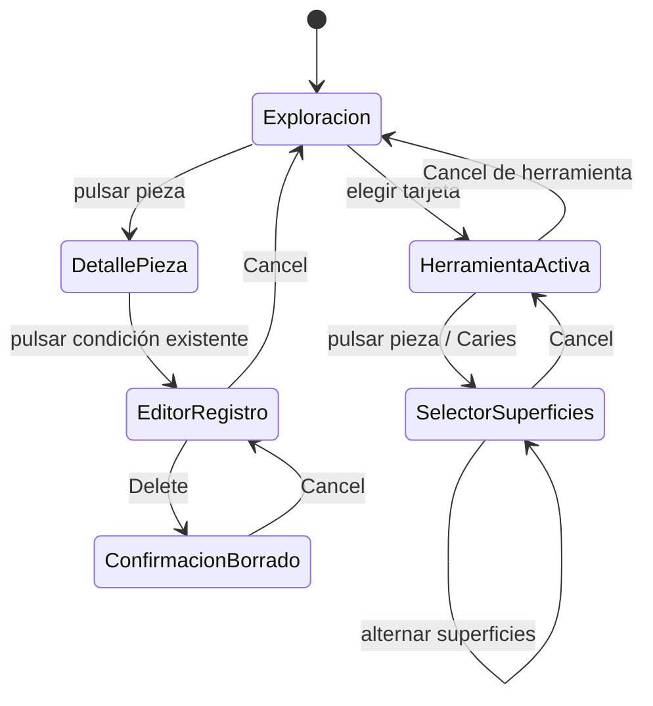

> Historical text recovered from this chat on 2026-10-17. Its previous binary screenshots were not recovered. This is prior context, not fresh visual proof. Fresh evidence and corrections are in ../audit/README.md.

# DentalPin: ingeniería inversa de Clinical → Diagnosis e History

Fecha de revisión: 16 de octubre de 2026, America/Santiago. Evidencia de esta sesión, obtenida sobre la aplicación local abierta por el usuario.

## 1. Qué documenta este informe

Este documento reconstruye el comportamiento observable de **Patients → ficha de paciente → Clinical → Diagnosis / History**: organización visual, odontograma, selección de condiciones, superficies, editores, confirmaciones, notas, recordatorios, historial y movimiento. «Levantograma» se interpreta aquí como el odontograma que la interfaz denomina **Dental Chart**.

**Treatment plans y Appointments quedan fuera del análisis.** Sus pestañas no se recorrieron. Cuando un control de Diagnosis conduce a otra superficie, se identifica únicamente esa salida. No se han eliminado ni ocultado pestañas en el producto: el alcance solicitado se aplica a esta documentación.

### Procedencia y grado de certeza

| Etiqueta | Significado |
|---|---|
| Observado | Acción realizada y resultado comprobado en la sesión autenticada del navegador nativo de Codex. |
| Medido | Propiedad leída del DOM renderizado o de sus estilos computados. |
| Inferido | Modelo explicativo compatible con la UI; no demuestra implementación interna. |
| Pendiente | Requiere otra prueba, acceso al código correcto o datos desechables. |

La página examinada se titula **DentalPin**, muestra Nuxt DevTools y componentes con identificadores Reka. Este repositorio describe AI Tutor/DynaChat y utiliza React/Vite. La búsqueda local de `DentalPin`, `clinicalMode`, `Register conditions` y `Diagnosed conditions` en su frontend no encontró la implementación de esta página. Por tanto, **este es un análisis de caja negra de DentalPin; no una reconstrucción verificada de sus servicios o base de datos**. Nuxt/Reka son indicios del frontend renderizado, no una auditoría de sus dependencias.

Herramientas empleadas:

- **Navegador nativo de Codex:** exploración autenticada, árbol de accesibilidad, Playwright integrado, capturas y estilos computados.
- **Playwright CLI:** sesión independiente `diagnosis-reverse-20261016`. La navegación al destino redirigió a `/login`; se verificó el formulario público y se cerró exclusivamente esa sesión. Su snapshot está en `.playwright-cli/diagnosis-public-login.yml`, ignorado por Git. La CLI **no realizó la exploración autenticada**.
- No se copiaron cookies, credenciales ni estados de autenticación entre navegadores.

No se confirmó `Save`, `Confirm` de alta clínica ni el último `Delete`. Todas las selecciones de formulario se cancelaron. No se crearon recordatorios, notas ni condiciones durante el recorrido. No se verificaron escrituras ni borrados mediante API o recarga. Los datos de la instancia se presentaban como demo, pero las capturas entregadas omiten identidad, contacto y texto de notas existentes. Los ejemplos de superficie son selecciones **sin guardar**.

## 2. Mapa visual y navegación

La superficie tiene cuatro capas:

1. **Aplicación:** navegación lateral y barra superior de clínica, ayuda y sesión.
2. **Paciente:** cabecera con identidad y acciones; pestañas principales de la ficha.
3. **Clinical:** navegación secundaria; en este informe solo Diagnosis e History.
4. **Trabajo:** odontograma y controles de la modalidad seleccionada.

En el viewport observado, aproximadamente **768 × 778 px**, la navegación lateral se reduce a iconos y aparece una barra inferior fija de acciones rápidas. El contenido requiere desplazamiento vertical. La barra inferior permanece visible al bajar hacia condiciones y notas.

### Diagnosis: orden de lectura

| Orden | Bloque | Función |
|---|---|---|
| 1 | Register conditions | Identifica la tarea de registro. |
| 2 | Dental Chart + Permanent / Primary | Representación gráfica y cambio de dentición. |
| 3 | Whole mouth | Registros de alcance global, separados de las piezas. |
| 4 | Diagnosis + categorías + tarjetas | Elegir qué condición aplicar. |
| 5 | Legend | Consultar simbología y estados. |
| 6 | Diagnosed conditions + contador | Inventario textual agrupado por pieza y accesos a notas/recall. |
| 7 | Diagnosis complete? | Salida hacia creación de plan, fuera del alcance. |

### URL y navegación: comportamiento real

Las transiciones internas entre Diagnosis e History cambian `clinicalMode=diagnosis` / `clinicalMode=history`. No cambian de paciente.

Sin embargo, la URL **no representa por sí sola todo el estado visible**:

- El botón rápido `Note` llevó a `?tab=summary#new-note`.
- Volver mediante la pestaña `Clinical` mostró Diagnosis mientras la dirección conservaba `tab=summary#new-note`.
- Cambiar después a History produjo `?tab=summary&clinicalMode=history`.
- Navegar directamente a la URL original, que solo contenía `clinicalMode=diagnosis`, abrió **Summary** en una carga nueva. Se volvió a Clinical mediante su pestaña.
- En Summary se observó un enlace `Open dental chart` cuyo destino sí incluye `?tab=clinical&clinicalMode=diagnosis`.

**Implicación:** para especificar enlaces compartibles debe considerarse también `tab=clinical`. No está demostrado que toda combinación de query/hash restaure la misma pantalla. El uso correcto del enlace anterior es una inferencia basada en su destino visible; no se recorrió como prueba adicional de carga nueva.

## 3. Odontograma: estructura y lectura

Cada pieza combina una representación lateral/anatómica, una vista oclusal y su número. La disposición conserva arcada superior e inferior y divide cada una en dos mitades. Las condiciones se superponen sobre los dibujos; varias condiciones pueden coexistir en una pieza.

### Denticiones

| Dentición | Superior, de izquierda a derecha en pantalla | Inferior, de izquierda a derecha en pantalla |
|---|---|---|
| Permanent | 18…11 · 21…28 | 48…41 · 31…38 |
| Primary | 55…51 · 61…65 | 85…81 · 71…75 |

Se observaron **32 piezas permanentes y 20 temporales**. El cambio de dentición actualiza el gráfico sin cambiar de paciente. No filtra necesariamente todo el resto de la página: al elegir Primary, el listado inferior seguía mostrando registros de piezas permanentes. No debe implementarse un filtrado del listado suponiendo que ya existe.

[Historical screenshot unavailable in this checkout: Dentición temporal sin condiciones representadas. See fresh audit/evidence captures instead.]

### Interacción sin herramienta activa

**Pieza sin registros → popover informativo**:

- Número de pieza.
- Nombre anatómico y localización.
- `No treatments recorded`.

**Pieza con registros → popover con contenido**:

- Número y nombre anatómico.
- Agrupación por estado, observada como `EXISTING`.
- Nombre de condición, superficies cuando aplican y fecha.
- Indicación `Click to edit`.

Pulsar el registro dentro del popover abre su editor modal. Pulsar la pieza es, por tanto, una entrada de inspección; pulsar la condición es otra acción distinta.

En el recorrido se abrió una pieza vacía, una restauración por superficies y una condición de pieza completa. No se comprobó la apertura por teclado de cada pieza.

### Representación y estados

- Se observaron rellenos coloreados, marcas sobre raíces y patrones tramados.
- Una `P` identifica un registro planificado en el gráfico y la leyenda distingue `Existing` y `Planned`.
- La codificación utiliza forma y dibujo además de color; no se verificó su legibilidad para todas las deficiencias de visión cromática.
- Los SVG contienen capas separadas para raíz, corona, pulpa, vista oclusal y resaltado. Esto se verificó por las clases de sus elementos renderizados.
- La equivalencia exacta entre cada variante comercial del catálogo y cada símbolo no se reconstruyó desde código.

### Whole mouth

Debajo del gráfico existe una lista independiente `Whole mouth`, con un chip `First Visit` en el caso observado. El DOM de ese chip es un `<button>` con `role="listitem"` y clase de estado existente.

Al pulsarlo se observó resaltado/foco, pero **no apareció un editor ni un modal**. No hay evidencia suficiente para atribuirle edición, eliminación o apertura de una consulta. El cambio de rol de botón a elemento de lista merece revisión de accesibilidad.

## 4. Elegir y aplicar condiciones

### Máquina de estados observable



El diagrama incluye exclusivamente transiciones ejercitadas. No representa como comprobadas las salidas que escriben datos.

### Exploración → herramienta activa

En reposo aparece `Select a treatment to apply`. Elegir `Caries`:

1. Resalta la tarjeta con fondo azul claro, borde y halo.
2. Identifica la condición activa junto al odontograma cuando ese encabezado está visible.
3. Muestra `Cancel`.
4. Cambia la instrucción a `Click on the tooth to apply`.

El catálogo está más abajo que el odontograma; elegir una tarjeta no equivale a aplicar el diagnóstico. Hay que volver a una pieza. La selección se mantiene tras cancelar el modal de superficies: debe distinguirse **cancelar la configuración de una pieza** de **salir del modo de aplicación**.

[Historical screenshot unavailable in this checkout: Herramienta activa y ayuda contextual. See fresh audit/evidence captures instead.]

Las tarjetas Caries, Incipient caries y Pigmentation muestran un pequeño punto cian y clase `is-surface`; se confirmó el selector de superficies con Caries. El punto parece señalar herramientas por superficie, pero no se comprobó ese contrato con todas las tarjetas.

### Catálogo de categorías

Se recorrieron las ocho categorías de la paleta dentro de Diagnosis. Este inventario **no implica navegar a Treatment plans**. Los nombres y variantes están en [CATALOGO.md](CATALOGO.md).

| Categoría | Tarjetas observadas |
|---|---:|
| Diagnostic | 12 |
| Restorative | 29 |
| Surgery | 9 |
| Endodontics | 10 |
| Orthodontics | 4 |
| Preventive | 1 |
| Periodontics | 1 |
| Pediatric | 6 |
| **Total del catálogo recorrido** | **72** |

Los conteos corresponden a esta instancia, dentición y configuración; no son un catálogo universal. Se observaron ayudas de precio por superficies para Composite filling, Amalgam filling y Primary tooth filling. No se comprobó cálculo de cobro ni moneda en esas ayudas.

### Modal Select Surfaces

Entrada comprobada: Caries activa → pieza temporal sin registros.

| Zona | Contenido/comportamiento |
|---|---|
| Cabecera | Select Surfaces; condición y número de pieza. |
| Dibujo izquierdo | OCCLUSAL VIEW con M, D, V, L, O. |
| Dibujo derecho | LATERAL VIEW. |
| Selección | Botones M Mesial, D Distal, O Occlusal, V Vestibular, L Lingual. |
| Resumen | Selected surfaces y chips de las superficies elegidas. |
| Contexto | Nombre anatómico de la pieza. |
| Pie | Contador, Cancel y Confirm. |

Estado inicial: cero superficies y `Confirm` deshabilitado. Seleccionar M y O resaltó ambos botones, coloreó las zonas correspondientes y mostró dos chips y `2 surface(s) selected`. Quitar ambas selecciones devolvió el contador a cero y deshabilitó Confirm.

[Historical screenshot unavailable in this checkout: Selección M y O, sin guardar. See fresh audit/evidence captures instead.]

Se comprobó selección múltiple y alternancia por botones. No se pulsaron los polígonos SVG como entrada alternativa ni se comprobó su soporte por teclado. No se pulsó Confirm: no se conoce por esta revisión si escribe inmediatamente, abre otro paso o mantiene la herramienta activa tras guardar.

En una instantánea inmediata durante el cierre apareció transitoriamente `Tooth 0` y una clave de traducción de pieza desconocida; la siguiente observación estable mostró el modal cerrado. Es un indicio de que se limpian datos antes de terminar la salida animada, **no un error persistente confirmado**.

## 5. Editar y eliminar un registro

### Editor de condición por superficies

Entrada comprobada: pieza con restauración → registro del popover.

- Título de condición y número de pieza.
- `Close` en cabecera.
- `Select Status`: Existing y Planned.
- `Select Surfaces`: M - Mesial, D - Distal, O - Occlusal, V - Vestibular y L - Lingual.
- Contador de superficies seleccionadas, precargado desde el registro.
- `Notes`: área de texto.
- Pie con Delete, Cancel y Save.

Este editor no es el modal gráfico de alta por superficies: expone un formulario compacto para un registro ya existente. Se comprobaron sus campos y cancelación; no se alteraron estados persistidos.

### Editor de condición de pieza completa

Entrada comprobada: pieza con Pulpitis → registro del popover.

El editor conserva título, pieza, Notes, Delete, Cancel y Save, pero **no muestra selector de superficies**. Para esta condición solo se ofrecía Existing en `Select Status`. Por tanto, no debe suponerse que todas las condiciones pueden planificarse o que comparten el mismo formulario.

### Confirmación de borrado

Delete del editor abrió una segunda capa modal con:

- Título `Delete`.
- Pregunta con nombre de condición y pieza.
- Advertencia `This cannot be undone.`
- Cancel y Delete.
- Foco inicial observado en Cancel.

Cancelar volvió al editor anterior, no directamente al odontograma. El último Delete no se ejecutó. No se verificó eliminación, notificación de éxito, actualización de contadores ni evento histórico posterior.

**Distinción necesaria sobre “eliminar la consulta”:** el flujo encontrado elimina una **condición de una pieza**. Dentro de Diagnosis/History no se encontró una entidad o botón inequívoco para eliminar una consulta completa. No se atribuye esa función al borrado de condición ni se investigó Appointments para buscarla.

## 6. Diagnosed conditions, notas y recordatorios

### Lista inferior de condiciones

Es un acordeón con chevron, icono, título y contador. Se comprobó plegado y reapertura. Cuando se cierra permanece el encabezado y el contador.

[Historical screenshot unavailable in this checkout: Acordeón cerrado. See fresh audit/evidence captures instead.]

Abierto, organiza las condiciones **por pieza**, no necesariamente una fila por condición. Una pieza con dos registros los muestra en una misma fila, separados visualmente por un punto. Las superficies se presentan abreviadas entre paréntesis.

Cada registro observado incorpora:

- Nombre de condición.
- Botón `Treatment notes (N)`.
- Botón `Set recall`.

El icono de notas cambia de apariencia y muestra el número cuando existen notas. El nombre accesible conserva el conteo incluso con cero.

**Contador frente a filas:** se observó un encabezado con 7, cuatro filas de piezas y cinco nombres de condición visibles. No son magnitudes intercambiables. La presencia de registros planificados y de boca completa podría explicar parte de la diferencia, pero no se verificó la fórmula del contador. No se afirma que el número sea incorrecto; falta conocer qué cuenta y qué filtra la lista.

### Popover de notas de tratamiento

Entrada: `Treatment notes (N)` de una condición.

| Estado | Contenido |
|---|---|
| Sin notas | Treatment notes · Tooth N; Add note; No notes on this treatment yet. |
| Con notas | Cabecera y Add note; autor o Unknown author; tipo/contexto; fecha; contenido; Open context. |
| Nueva nota | Templates; General follow-up; textarea; adjunto; Cancel; Save. |

`Add note` dirige el foco al área de texto. El placeholder es `Write the note…`. Vacío, Save estaba deshabilitado. La plantilla **General follow-up** insertó:

```text
Findings:
Procedure performed:
Patient instructions:
```

Con esa plantilla Save se habilitó, aunque los apartados estaban sin completar. Esto prueba validación por contenido suficiente para habilitar el botón; no demuestra validación semántica en servidor.

[Historical screenshot unavailable in this checkout: Formulario vacío de nota. See fresh audit/evidence captures instead.]

Se observó `Attach photo or document`; no se abrió un selector de archivos ni se subieron adjuntos. Tampoco se pulsó Open context: su destino no se verificó. Cancel descartó el borrador y permitió cerrar el popover con Escape.

### Tres conceptos distintos de “notas”

1. **Notes del editor:** campo de un registro clínico existente.
2. **Treatment notes:** colección contextual con autor, fecha, plantilla y adjuntos.
3. **Note de barra rápida:** navegación a Summary con `#new-note`, fuera del cuerpo de Diagnosis.

Además, el árbol accesible expuso un botón **Notas** dentro de Diagnosis. Al activarlo se abrió **IA**, con Chat seleccionado, sugerencias y cuadro de envío. Se cerró sin enviar texto. Es una discrepancia entre etiqueta y resultado observado; no se puede dar por hecho que sea el mismo acceso que Note ni que sea un formulario de notas clínicas.

### Set recall

Set recall, junto a una condición, abre un modal `Flag the patient for a future call-back`. No se navegó a Appointments.

| Campo | Opciones observadas |
|---|---|
| Reason | Hygiene, Check-up, Ortho review, Implant review, Post-op, Treatment follow-up, Other. |
| Atajos | +1m, +3m, +6m, +12m. |
| Mes | Selector de mes y texto Target month. |
| Día opcional | Pick a specific day, expandible, con campo de fecha. |
| Priority | Low, Normal, High. |
| Internal note | Área de texto opcional. |
| Salida | Close, Cancel, Save. |

Se observó Treatment follow-up preseleccionado y prioridad Normal. Expandir Pick a specific day mostró el campo y acceso al selector de fecha. No se verificaron navegación del calendario, recálculo de atajos o persistencia de Save.

[Historical screenshot unavailable in this checkout: Recordatorio sin guardar. See fresh audit/evidence captures instead.]

En el ancho observado varios motivos se truncan visualmente, mientras el árbol accesible conserva el nombre completo. El cuerpo del modal tiene scroll interno y el pie mantiene acciones visibles.

## 7. History: reconstrucción temporal

History cambia el cuerpo de Clinical por:

1. Tarjeta Timeline.
2. Control temporal con marcas y slider.
3. State at con fecha o Today.
4. Dental Chart con distintivo View only y denticiones.
5. Whole mouth y Legend.
6. Changes on this date para las fechas con cambios.
7. Acordeones Treatment List y Change History.

### Línea temporal

El caso observado tenía cuatro posiciones: tres fechas y Now. La entrada inicial quedó en la tercera fecha histórica, **no en Today**. Reabrir History durante el recorrido volvió a esa posición; no se puede asumir conservación de la última selección temporal.

Se ejercitaron Home, ArrowRight y End sobre el slider:

| Posición | Marca visible | State at observado |
|---:|---|---|
| 0 | Sep 2 | 9/1/2026 |
| 1 | Oct 3 | 10/2/2026 |
| 2 | Oct 6 | 10/5/2026 |
| 3 | Now | Today |

`Return to current state` aparece en dos lugares: cabecera de tarjeta y control interior. Pulsar el primero mueve el slider a Now y muestra Today, **manteniendo History**. No devuelve a Diagnosis. En Today desaparecieron ambos botones de retorno y el bloque Changes on this date.

[Historical screenshot unavailable in this checkout: Timeline y State at difieren un día. See fresh audit/evidence captures instead.]

Las etiquetas visibles son ambiguas por formato regional. El desplazamiento sistemático de un día es compatible con conversiones diferentes de fecha/zona horaria, pero **la causa no se verificó**: no se inspeccionó el parser ni las respuestas de la API de DentalPin.

### Cambios por fecha

El bloque Changes on this date cambia con el slider. Se observaron grupos `Treatment` y `Completed`; el primero puede incluir Planned, y el segundo incluye condiciones que no son necesariamente procedimientos terapéuticos. El rótulo Completed debe interpretarse como clasificación de esta interfaz, sin asumir una semántica clínica más amplia.

En distintas posiciones se observaron registros nuevos diferentes. No se verificó el algoritmo de reconstrucción del odontograma, el orden de aplicación de eventos ni el tratamiento de registros borrados.

### Treatment List y Change History

Ambos se expandieron en History, sin entrar a Treatment plans.

| Sección | Datos visibles |
|---|---|
| Treatment List | Número/nombre de pieza, condición, superficies, Existing/Planned y fecha. |
| Change History | Pieza, nombre anatómico, tipo de evento Treatment, condición/estado, fecha/hora y autor cuando existe. |

El encabezado Treatment List mostraba 9, pero se observaron seis registros en su contenido desplegado. Change History mostraba 6 y seis registros. Igual que en Diagnosis, queda pendiente explicar la fórmula, los filtros o posibles tipos omitidos; no se deduce automáticamente un fallo de datos.

### View only no impide abrir edición

Se comprobó esta secuencia dos veces:

1. History en una fecha anterior a Today.
2. Dental Chart indica View only.
3. Pulsar una pieza con condición abre el popover.
4. El popover conserva Click to edit.
5. Pulsar la condición abre el editor con Notes, Delete, Cancel y Save habilitados.

[Historical screenshot unavailable in this checkout: Controles habilitados del editor abierto desde History. See fresh audit/evidence captures instead.]

Esto demuestra una contradicción de interfaz y acceso a controles de edición desde una vista histórica. **No demuestra que el backend acepte la escritura ni que una modificación altere el pasado.** No se pulsó Save/Delete final para comprobarlo.

## 8. Animaciones y microinteracciones

Las duraciones siguientes se midieron en estilos computados, no se estimaron a partir de capturas. Las transiciones describen capacidad de interpolación del estilo; no garantizan que cada interacción cambie todas las propiedades.

| Elemento | Propiedades | Duración / curva observada |
|---|---|---|
| Envoltorio de pieza, superior/inferior | transform, filter | 150 ms. |
| Raíz y corona SVG | fill, stroke | 150 ms. |
| Pulpa SVG | fill; stroke | 200 ms; 150 ms. |
| Vista oclusal | fill, stroke | 150 ms. |
| Resaltado y borde oclusal | stroke | 150 ms. |
| Número de pieza | color | 150 ms. |
| Tarjeta de condición | background, border-color, box-shadow, transform | 150 ms. |
| Categoría | background-color, color | 150 ms; cubic-bezier(0.2, 0, 0.2, 1). |
| Chip Whole mouth | background, border-color, box-shadow, transform | 150 ms. |
| Cabecera Legend | background-color | 150 ms. |
| Fondo de modal | fade-in / fade-out | 200 ms ease-out / ease-in, según clases de estado. |
| Contenido de modal | scale-in / scale-out | 200 ms ease-out / ease-in, según clases de estado. |
| Botones generales | colores, fondo, borde y otras propiedades cromáticas | 150 ms; cubic-bezier(0.4, 0, 0.2, 1). |

Las clases SVG y transiciones de base se conservan en historical motion-rendered.json (unavailable; fresh measurements are in ../audit/). Las mediciones de los modales se realizaron con ellos abiertos y sus clases `data-state` visibles. No se midió el rendimiento por fotograma ni la duración exacta de los acordeones, los popovers o el desplazamiento temporal.

No se observaron animaciones continuas en los elementos del odontograma medidos en reposo (`animation: none`). No se concluye que no existan otras animaciones condicionales. No se comprobó `prefers-reduced-motion`, hover puro para cada herramienta, dispositivos táctiles ni todos los breakpoints.

### Detalles de interacción relevantes

- Al abrir modales, el fondo se atenúa y el foco pasa a controles de la capa activa.
- El selector de superficies dirigió foco al primer botón de superficie.
- El editor dirigió foco al cierre; cancelar la confirmación devolvió foco a Delete del editor.
- Las notas nuevas enfocaron el textarea.
- Los controles pueden seguir apareciendo transitoriamente en el árbol durante una salida de 200 ms; las conclusiones se basan en estados estables.
- La selección activa tiene borde, halo y texto de ayuda; no depende únicamente del color.
- Las piezas se renderizan como contenedores y SVG, sin rol/tabindex en los elementos medidos. Queda pendiente comprobar si otro ancestro proporciona toda la operación por teclado.

## 9. Hallazgos de UX y accesibilidad

| Prioridad propuesta | Hallazgo | Evidencia y consecuencia |
|---|---|---|
| Alta | View only permite abrir un editor activo | Secuencia de §7 y captura 08. Puede inducir a editar un registro actual creyendo consultar el pasado. Falta verificar la barrera de escritura. |
| Alta | Marcas temporales y State at difieren un día | Tabla y captura 07. El usuario recibe dos fechas para una misma posición. |
| Media | Estado de pestañas y URL pueden divergir | Secuencias de §2. Compartir o recargar una dirección puede restaurar otra superficie. |
| Media | Contadores sin significado evidente | Diagnosed conditions y Treatment List no coinciden con filas/entradas visibles. Hace falta definir unidad y filtros. |
| Media | Nombres accesibles inconsistentes para notas | Notas abrió IA; Note llevó a Summary. Riesgo de navegación inesperada. |
| Media | Operación del odontograma por teclado no demostrada | Contenedores/SVG sin semántica de control en la muestra. Necesita prueba de recorrido y activación. |
| Baja | Texto genérico de “treatment” en tarea Diagnosis | Select a treatment to apply y No treatments recorded mezclan conceptos de condición y tratamiento. |
| Baja | Motivos de recall truncados | Captura 04. Deben poder leerse mediante foco, tooltip o expansión adecuada. |
| Investigación | Limpieza de datos durante cierre | Instantánea transitoria Tooth 0/clave i18n. Verificar en vídeo antes de clasificar como defecto visible. |

Aspectos que funcionaron en el recorrido: separación gráfica/textual, selección múltiple de superficies con contador, Confirm deshabilitado con cero superficies, borrado con segunda confirmación, notas con estado vacío, contexto de pieza en formularios y retorno explícito al presente.

Esto no certifica accesibilidad WCAG, contraste, trampa completa de foco, navegación con lector de pantalla o recuperación de errores de servidor.

## 10. Modelo conceptual para reconstruir el flujo

**Inferencia de diseño; no esquema de la base de datos de DentalPin.**

| Entidad/estado | Información mínima que sugiere la UI |
|---|---|
| Paciente | Identidad de contexto y propietario de registros. |
| Dentición | Permanent / Primary. |
| Pieza | Número, nombre anatómico, arcada y lateralidad. |
| Definición de condición | Categoría, etiqueta, símbolo, alcance, superficies aplicables y estados permitidos. |
| Registro | Referencia de condición, pieza o boca completa, estado, superficies, fecha y Notes. |
| Nota contextual | Registro/contexto, autor, fecha, texto y posibles adjuntos. |
| Recall | Contexto, motivo, mes/día opcional, prioridad y nota interna. |
| Evento histórico | Tipo, registro afectado, fecha/hora y autor. |
| Estado de UI | Modal abierto, condición activa, categoría, dentición, acordeones y posición temporal. |

Para una reconstrucción fiel hay que separar: estado clínico persistido, borrador de un formulario, herramienta de aplicación activa y fecha histórica de lectura. Mezclarlos reproduce riesgos como limpiar datos antes de cerrar un modal o ofrecer escritura en una vista marcada como lectura.

## 11. Cobertura y pruebas pendientes

La matriz de pasos y criterios de aceptación está en [COBERTURA.md](COBERTURA.md). Este informe ofrece detalle del recorrido explorado, **no cobertura exhaustiva de todas las combinaciones de datos y fallos**.

Falta comprobar con una cuenta/dataset desechable y acceso a la implementación correcta:

- Alta real por pieza completa y por superficies; comportamiento de Confirm y repetición sobre varias piezas.
- Edición de estado/superficies/Notes con recarga y verificación de persistencia.
- Borrado final, actualización de lista/gráfico/historial y recuperación, si existe.
- Guardado, edición, eliminación y adjuntos de notas; destino de Open context.
- Guardado y cancelación posterior de recalls; reglas de fechas y selección de motivos.
- Duplicados, incompatibilidades entre condiciones, piezas ausentes y registros concurrentes.
- Vacíos de paciente, catálogos configurables, errores HTTP, reintentos y conservación de borradores.
- Permisos, aislamiento por paciente/usuario y barreras del backend para History.
- Fórmulas de contadores y algoritmo temporal, incluida su zona horaria.
- Teclado completo, lector de pantalla, móvil real, escritorio ancho y reducción de movimiento.
- Existencia y ubicación de un borrado de **consulta completa**, si es una entidad distinta y dentro del alcance acordado.

La pestaña original permanece abierta en Clinical → Diagnosis. La sesión adicional de Playwright CLI quedó cerrada. El único cambio de archivos del proyecto corresponde a este paquete de documentación y evidencia.
